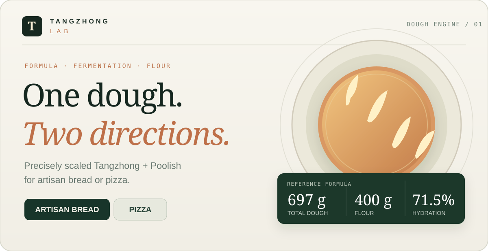

# Tangzhong Lab

[](https://fernando-parodi.github.io/tangzhong-lab/)

**One dough. Two directions.** An interactive, browser-based recipe calculator for artisan bread and pizza built around a Tangzhong–Poolish formula.

### **[↗ Open the live application](https://fernando-parodi.github.io/tangzhong-lab/)**

[**Use the dough calculator**](https://fernando-parodi.github.io/tangzhong-lab/#workbench) · [**Read the source code**](https://github.com/fernando-parodi/tangzhong-lab/tree/main) · [**View the formula tests**](tests/recipe.test.mjs)

Tangzhong Lab combines precise ingredient scaling with guided preparation methods. It is a lightweight static application: no account, backend, build step, or third-party JavaScript framework is required.

## Try it

1. Choose **Artisan bread** or **Pizza**.
2. Enter the number of loaves or pizza balls and the desired dough weight.
3. Review the automatically scaled Tangzhong, Poolish, and final-dough ingredients.
4. Follow the preparation method, use the timer, and print or copy the finished batch sheet.

**Example:** Select *Pizza*, 4 balls at 250 g each. The calculator produces **1,000 g of total dough** with ingredient quantities adjusted to match. For the source bread formula, choose 1 loaf at 697 g.

## Features

- **Bread and pizza workflows** — Batard loaves baked in a Dutch oven, or round and pan-style pizza.
- **Weight-based scaling** — Choose the number of loaves or pizza balls and the target weight per piece.
- **Baker's percentages** — Flour, water, salt, and yeast are recalculated from the requested yield.
- **Separated preferments** — Distinct ingredient lists for Tangzhong, Poolish, and final dough.
- **Fermentation options** — Reference bread process, same-day pizza, and a reduced-yeast overnight pizza adaptation.
- **Guided method** — Step-by-step instructions, progress checkboxes, and a countdown timer.
- **Local persistence** — Preferences and progress are saved in the browser, without an external account.
- **Print and copy** — Generate a practical batch sheet from the current selections.

## Reference formula

The bread baseline yields **697 g of dough**, using **400 g total bread flour** and **286 g total water**.

| Stage | Ingredient | Baker's % | Baseline |
|---|---|---:|---:|
| Tangzhong | Bread flour | 15% | 60 g |
| Tangzhong | Boiling water | 30% | 120 g |
| Poolish | Bread flour | 20% | 80 g |
| Poolish | Water | 20% | 80 g |
| Poolish | Instant yeast | 0.20% | 0.8 g |
| Final dough | Bread flour | 65% | 260 g |
| Final dough | Cold water | 21.50% | 86 g |
| Final dough | Instant yeast | 0.80% | 3.2 g |
| Final dough | Salt | 1.75% | 7 g |
| **Total** | **Flour** | **100%** | **400 g** |
| **Total** | **Water** | **71.50%** | **286 g** |
| **Total** | **Instant yeast** | **1.00%** | **4 g** |
| **Total** | **Salt** | **1.75%** | **7 g** |
| **Total** | **Dough** | **174.25%** | **697 g** |

The source bread formula rounds hydration to 72%; the calculator uses the exact value **71.5%** (286 ÷ 400). Flour and water incorporated into Tangzhong and Poolish are **included** in the overall totals.

### Calculation model

Let **D** be the target total dough mass and **F** the required total flour mass. Baker's percentages are defined relative to **F**.

```text
F = D / (1 + hydration + salt_fraction + yeast_fraction)

Reference bread / same-day pizza:
F = D / (1 + 0.715 + 0.0175 + 0.0100)
  = D / 1.7425

Reduced-yeast overnight pizza:
F = D / (1 + 0.715 + 0.0175 + 0.0020)
  = D / 1.7345
```

Each ingredient is computed from unrounded flour mass, then formatted for display. Because ingredient weights are rounded independently on screen, their displayed sum can differ slightly from the target batch weight.

## Baking workflows

### Artisan bread

The reference method uses a Poolish fermented until its peak, a hot-water Tangzhong paste, ice-cold mixing water, and a short refrigerated bulk fermentation with two rounds of folds. The dough is shaped as a batard, cold-proofed, and baked in a preheated Dutch oven.

### Pizza

Pizza mode is a **practical adaptation** of the bread formula, not a transcription of the original bread process. It retains the Tangzhong and Poolish proportions but changes the dough handling, proofing, shaping, and baking instructions.

- **Same-day:** Retains 1.00% total instant yeast.
- **Overnight:** Uses 0.20% instant yeast in the Poolish and omits final-dough yeast.

The resulting dough has relatively high hydration; pan pizza can be easier to handle than a free-form round. Fermentation duration depends on dough temperature, flour strength, yeast activity, and refrigerator performance. Use visual dough development alongside the estimated timings. Take care with preheated cookware and steam.

## Architecture

The application separates recipe math, presentation, and UI state:

| File | Purpose |
|---|---|
| `index.html` | Semantic HTML entry point for GitHub Pages |
| `styles.css` | Responsive styles and print formatting |
| `recipe.js` | Formula scaling and preparation-method data |
| `app.js` | User interactions, timer, and browser-local persistence |
| `preview.html` | Self-contained HTML distribution for opening directly |
| `tests/recipe.test.mjs` | Automated recipe and workflow checks |
| `favicon.svg` | Project icon |
| `package.json` | Project metadata and test command |
| `.nojekyll` | Static hosting configuration |

The project is served directly from the `main` branch through GitHub Pages.

## Local development

The standalone `preview.html` file can be opened directly in a browser.

For the modular source, serve the repository directory with any static HTTP server, for example:

```bash
python -m http.server 8000
```

Open `http://localhost:8000`.

Run the automated checks with Node.js 18 or newer:

```bash
npm test
```

No `npm install` is necessary; the tests use Node's built-in test runner.

## Possible extensions

Dough-temperature planning, editable hydration, flour presets, fermentation scheduling, saved batches, and ingredient cost estimation.

## License

The application source code is available under the [MIT License](LICENSE).

---

**Tangzhong Lab** · [Live app](https://fernando-parodi.github.io/tangzhong-lab/) · [Fernando Parodi](https://github.com/fernando-parodi)
